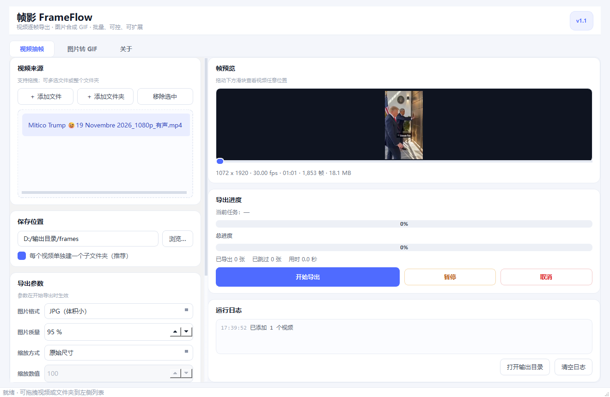
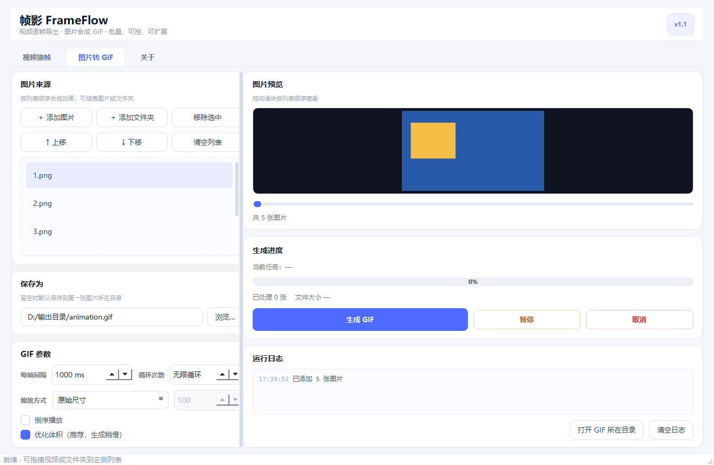
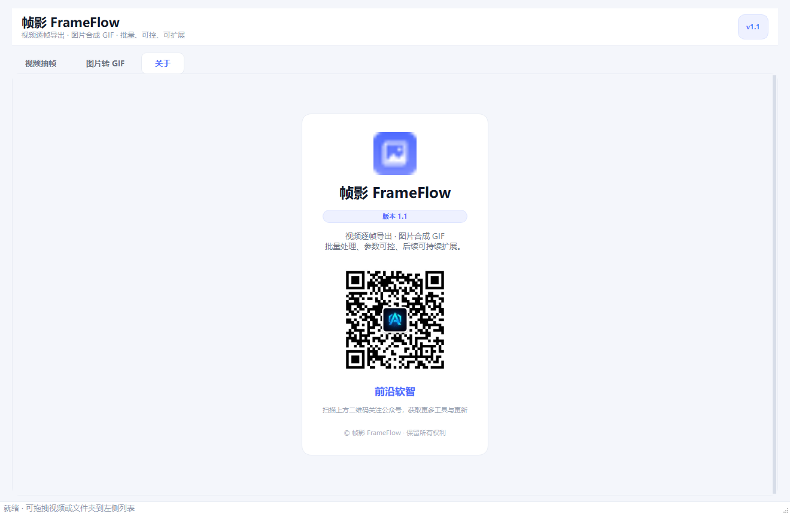

# 帧影 FrameFlow

一个把**视频逐帧导出为图片**、把**多张图片合成为 GIF 动画**的桌面小工具。

基于 Python + PySide6 + OpenCV + Pillow，界面简洁、支持批量处理，可暂停/取消，参数可记忆，后续也方便继续扩展功能。

---

## 功能一览

- **视频抽帧**：单文件 / 整个文件夹批量导入，支持拖拽；逐帧、每隔 N 帧、每秒 N 张三种抽帧方式；可截取时间段、缩放、换格式、自定义命名
- **图片转 GIF**：多张图片按列表顺序合成动画；支持调整顺序、间隔、循环次数、缩放、倒序、优化体积
- **帧预览**：视频可拖动滑块看任意一帧；图片列表可逐张预览
- **任务控制**：后台执行，不卡界面；支持暂停 / 继续 / 取消，带进度条与运行日志
- **设置记忆**：参数自动保存，下次打开保持上次配置
- **关于页**：内置软件信息与公众号二维码

---

## 界面截图

### 视频抽帧



### 图片转 GIF



### 关于



---

## 环境要求

- Windows 10 / 11
- Python 3.10 及以上（已在 Python 3.13 测试）
- 依赖：`PySide6`、`opencv-python-headless`、`Pillow`

## 安装与启动

**方式一：直接双击 `启动工具.bat`（推荐）**

脚本会先检查依赖，发现缺失时自动执行 `pip install`，然后启动程序。

**方式二：命令行启动**

```bash
pip install -r requirements.txt
python main.py
```

> 注意：请使用同一个 Python 环境安装依赖并启动程序。如果双击 `.bat` 报 `No module named PySide6`，通常是系统里有多个 Python，脚本已内置自动补装逻辑。

---

## 使用说明

### 一、视频抽帧

1. 打开软件，默认停在「视频抽帧」标签页。
2. 点击 **添加文件** 选择多个视频，或点击 **添加文件夹** 批量导入；也可以直接把视频/文件夹拖进左侧列表。
3. 在「保存位置」里选择导出目录。留空时程序会自动在第一个视频所在目录创建 `frames_export`。
4. 在「导出参数」里按需设置，常用的几项：
   - **图片格式**：JPG（体积小）、PNG（无损）、WebP（兼顾）
   - **图片质量**：1–100，越高文件越大；PNG 下该值映射为压缩级别
   - **缩放方式**：原始尺寸 / 指定宽度 / 指定高度 / 按比例
   - **抽帧方式**：全部帧（每一帧都保存）、每隔 N 帧、每秒 N 张
   - **开始时间 / 结束时间**：只导出某一段时间，结束时间填 0 表示到片尾
   - **命名模板**：默认 `{name}_{index:06d}`，生成如 `视频名_000001.jpg`
   - **最多保存**：限制张数，先用小数量试跑很方便
5. 点击 **开始导出**。过程中可以暂停、继续或取消；进度、统计和日志显示在右侧。
6. 导出完成后点 **打开输出目录** 直接查看图片。

**命名模板可用变量**

| 变量 | 含义 |
| --- | --- |
| `{name}` | 视频文件名（不含扩展名） |
| `{index}` | 导出图片序号，从 1 开始 |
| `{frame}` | 原视频中的帧号 |
| `{fps}` | 视频帧率 |

示例：`{name}_f{frame:06d}` 会按原始帧号命名，方便和视频时间轴对应。

---

### 二、图片转 GIF

1. 切换到「图片转 GIF」标签页。
2. 点击 **添加图片** 或 **添加文件夹**，也可以直接拖入图片。列表顺序就是 GIF 的播放顺序，用 **上移 / 下移** 调整。
3. 在「保存为」指定输出路径，例如 `D:\图片\动画.gif`；留空则默认保存到第一张图片所在目录，文件名 `animation.gif`。
4. 设置 GIF 参数：

| 参数 | 说明 |
| --- | --- |
| 每帧间隔 | 每张图停留的毫秒数，默认 100 ms（约 10 fps） |
| 循环次数 | 0 表示无限循环，也可指定具体次数 |
| 缩放方式 | 原始尺寸 / 指定宽度 / 指定高度 / 按比例 |
| 倒序播放 | 勾选后按列表反序生成 |
| 优化体积 | 勾选后文件更小，但生成稍慢 |

5. 点击 **生成 GIF**，右侧显示进度和文件大小，完成后可打开所在目录。

> 图片支持 JPG / PNG / WebP / BMP / GIF / TIFF。带透明通道的图片会自动合成到白底，避免出现黑块。多帧 GIF 作为输入时只取第一帧。

---

### 三、关于页

右上角第三个标签「关于」展示软件名、版本、功能简介、软件图标，以及公众号二维码。


公众号：**前沿软智** —— 扫码关注，获取更多工具与更新。

---

## 注意事项

1. **磁盘空间**：1080p 视频按「全部帧 + 原始尺寸」导出，一分钟视频可能产生上千张图片、占用 1 GB 左右。建议先用「最多保存」试跑，或配合缩放 / 每秒 N 张使用。
2. **中文与 emoji 路径**：程序已处理 Windows 下 OpenCV 对非 ASCII 路径的兼容问题，路径含中文或 emoji 均可正常读写。
3. **同名文件**：默认跳过已存在的图片；勾选「覆盖同名图片」则会重新写入。批量重跑时建议留默认。
4. **暂停与取消**：任务在后台线程运行，暂停时不会继续解码；取消会停止当前及后续任务，已导出的图片保留。
5. **参数记忆**：所有参数保存在本地 QSettings 中，关闭程序后仍保留。

---

## 项目结构

```text
.
├── main.py                     # 程序入口
├── 启动工具.bat                 # Windows 双击启动（自动补依赖）
├── requirements.txt            # 依赖清单
├── app/
│   ├── assets/                 # 图标与公众号二维码
│   ├── core/
│   │   ├── config.py           # 抽帧配置模型
│   │   ├── extractor.py        # 视频抽帧引擎
│   │   ├── gif_maker.py        # GIF 合成引擎
│   │   └── utils.py            # 文件扫描与工具函数
│   ├── ui/
│   │   ├── main_window.py      # 主窗口
│   │   ├── gif_page.py         # 图片转 GIF 页面
│   │   ├── about_page.py       # 可复用的关于页组件
│   │   └── theme.py            # 界面样式
│   └── workers/
│       ├── extract_worker.py   # 抽帧后台线程
│       └── gif_worker.py       # GIF 后台线程
└── docs/screenshots/           # README 配图
```

## 扩展方向

核心引擎与界面完全分离，方便后续加功能：

- `FrameExtractor.add_processor(fn)` 可挂接裁剪、水印、滤镜、OCR 等帧处理逻辑
- 可接入命令行，做定时 / 批处理任务
- 可增加视频格式转换、图片批量重命名等标签页
